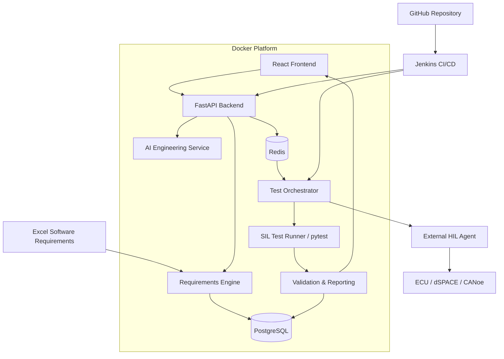

# EVAP — Embedded Validation Automation Platform

## A Universal CI/CD Validation Platform for Embedded Software Systems

### System Architecture

### Core Capabilities

- Requirements-driven validation
- Automated test case management
- Docker-based execution infrastructure
- Jenkins CI/CD integration
- SIL / PIL / HIL test orchestration
- AI-assisted test engineering
- End-to-end requirements traceability
- Centralized validation reporting

### Technology Stack

| Layer | Technology |
|---|---|
| Frontend | React / TypeScript |
| Backend | Python / FastAPI |
| Infrastructure | Docker / Docker Compose |
| CI/CD | Jenkins / GitHub |
| Database | PostgreSQL |
| Task Queue | Redis |
| Testing | pytest |
| AI | OpenAI / Claude |
| Embedded Validation | SIL / PIL / HIL |

### Architecture Principles

- Modular and scalable architecture
- Hardware-independent test execution
- Reproducible testing environments
- Requirements-to-results traceability
- Deterministic validation verdicts
- Human review of AI-generated tests
- Secure integration with external test benches
