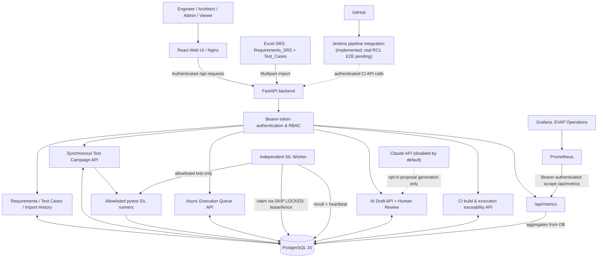
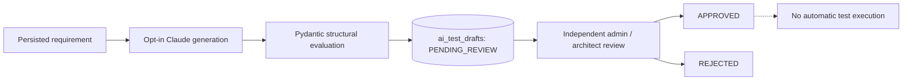
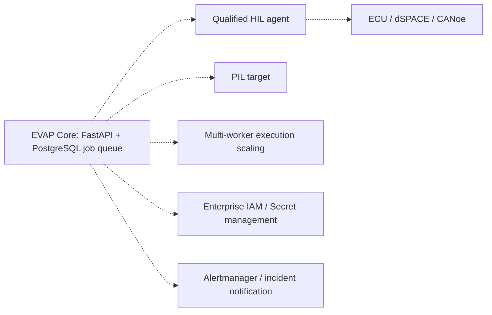

# EVAP — Embedded Validation Automation Platform

## A Universal CI/CD Validation Platform for Embedded Software Systems

**Architecture status:** v1.0.0-rc.1 (tagged release candidate, locally accepted 2026-11-25).  
**Documentation scope:** implemented RC1 architecture **and** explicitly separated future capabilities.  
**Release commit:** `d0e7b4301cfae97b99a67c2b8f40fc1368b85f40`.  
**Deployment status:** local isolated acceptance passed; **not** a production release. The `main` branch contains this architecture document but not necessarily the RC1 implementation. The code is in the `feature/evap-industrial-reliability-v1.0` branch and the immutable `v1.0.0-rc.1` tag.

## 1. Implemented architecture (RC1)



**Actual RC1 Docker Compose services:** `db`, `backend`, `sil-worker`, `frontend`, plus optional `prometheus` and `grafana` through `compose.monitoring.yml`. The queue is **PostgreSQL-backed**, not Redis-backed. **There is no operational Redis service in the RC1 Compose stack.** The AI backend is integrated into FastAPI, not deployed as a separate AI microservice.

## 2. End-to-end functional flows

### 2.1 Requirements import and traceability

1. Engineer imports an `.xlsx` file at `POST /api/requirements/import` (5 MB maximum).
2. Backend checks `Requirements_SRS` columns `Requirement_ID` and `Description`, plus optional `Test_Cases` columns `Test_ID` and `Requirement_ID`.
3. Requirements and test cases are replaced **atomically** in PostgreSQL; the import is recorded in `imports`.
4. `GET /api/dashboard` computes requirements, test cases, distinct mapped requirements, executed test count, pass/fail/error totals and pass rate from persisted records.

**Important:** an import replaces the *current* requirements and test-case records, rather than versioning a baseline; coordinate imports with ongoing test executions. Historic execution records may remain, so dashboards are not a release-baseline certification by themselves.

### 2.2 Distributed asynchronous SIL execution

```mermaid
sequenceDiagram
    actor E as Engineer
    participant UI as React
    participant API as FastAPI /api/jobs
    participant DB as PostgreSQL
    participant W as SIL Worker
    participant P as pytest SIL
    E->>UI: Select TC-004 and submit
    UI->>API: POST /api/jobs + idempotency_key
    API->>DB: Validate registered SIL test; enqueue
    API-->>UI: 202 + job ID
    W->>DB: Claim QUEUED job (SKIP LOCKED, lease)
    DB-->>W: Leased RUNNING job
    W->>P: Run allowlisted pytest selector (30s timeout)
    P-->>W: Verdict + bounded logs
    W->>DB: Atomic result persistence with lease token fence
    UI->>API: GET /api/jobs/{id}
    API-->>UI: COMPLETED + execution_id
```

- Job states: `QUEUED`, `RUNNING`, `COMPLETED`, `ERROR`, `INTERRUPTED`, `CANCELLED`. Not all transitions are exposed as public APIs.
- Unique `(requested_by, idempotency_key)` avoids duplicate creation for identical requests. A mismatched request with the same key is rejected.
- Database leasing, `FOR UPDATE SKIP LOCKED` and lease-token fencing protect against duplicate claims and stale worker writes; expired running leases are marked interrupted, **not automatically replayed**.
- Worker supports **SIL only** in RC1. Runner validates a fixed allowlist, uses isolated environment variables, sets a 30-second execution timeout, and truncates logs; it is **not** a hardened OS-level sandbox.
- Executable tests in RC1: `TC-004` (CAN timeout), `TC-008` (startup), `TC-009` (CAN transmission), `TC-011` (SOC calculation). Eight additional SRS cases were not executable in local acceptance.
- `POST /api/campaigns` is the existing **synchronous** multi-test campaign path; it is not the same as the distributed job queue.

### 2.3 AI-assisted test engineering (opt-in)



- API endpoints: `POST /api/ai-drafts`, `GET /api/ai-drafts`, `PATCH /api/ai-drafts/{id}`.
- `EVAP_AI_ENABLED=false` is the default. Generation then returns **HTTP 503** and creates no proposal.
- When explicitly enabled with configured credentials, the backend calls Anthropic Claude to propose structured tests. Generated drafts require structural evaluation and human review; review must be by a distinct authenticated identity. Approval also checks that the requirement description has not changed.
- A structurally valid or approved AI draft is **not** an executable test. No automatic script generation, HIL execution or live provider validation was established by RC1 local acceptance.
- Avoid sharing confidential requirements with an external model without explicit authorization and data-handling controls.

### 2.4 Jenkins traceability and reconciliation

- Jenkinsfile and `ci/evap_http.py` implement CI build registration/finalization, campaigns and result collection through authenticated API calls.
- CI-service RBAC identity is authorized for CI build mutations; normal users cannot use those write endpoints.
- Reconciliation components `jenkins_client.py`, `build_identity.py`, `reconciliation_service.py` and `reconciliation_worker.py` implement build identity verification, conservative status decisions, audit events and an advisory-lock recovery worker.
- **RC1 limitation:** `reconciliation_runtime.py` is explicitly guarded to an isolated lab database and defaults to dry-run. It is not a general production daemon; the real authenticated Jenkins integration was not qualified in the RC1 local acceptance.
- Build finalization, interrupted pipelines and audit data should be verified with a trusted Jenkins installation before release.

### 2.5 Security and observability

- Bearer tokens are matched to SHA-256 digests configured via `EVAP_IDENTITIES_JSON`; roles: `admin`, `architect`, `engineer`, `viewer`, `ci`. `EVAP_AUTH_MODE=required` is the normal setting; `development` bypass is intended only for isolated testing.
- RBAC restricts mutation routes, AI review and CI operations. This is a **route-level authorization layer**, not a full enterprise IAM system, and does not implement per-project tenant isolation.
- `/api/health` is public; `/api/metrics` is authenticated. Security audit log entries include denied access and authenticated mutations without tokens or request bodies.
- Prometheus uses a bearer-token file to scrape the metrics endpoint every 15 seconds. Grafana provisions the `EVAP Operations` dashboard with six panels: active workers, execution jobs, test executions, AI drafts, expired job leases and reconciliation events.
- The stack contains Prometheus alerting rules for API availability, expired leases, queue backlog and lack of active workers. **Alert delivery** (e.g., Alertmanager notifications) is not qualified by local acceptance.
- **Secret ownership requirement:** Prometheus runs as UID 65534 in the tested container and must be able to read `/run/secrets/metrics_token`. During isolated qualification the host file needed owner `65534:65534` and mode `0400`. Verify user mappings before replicating this fix, and do not make the bearer token world-readable.

## 3. Implemented technology stack

| Layer | RC1 implementation | Notes |
|---|---|---|
| Web UI | React / JavaScript / Vite, served by Nginx | API bearer token kept in browser memory |
| API | Python / FastAPI | API reports internal version `0.3.0`; release tag is `v1.0.0-rc.1` |
| Persistence and queue | PostgreSQL 16 / psycopg | Requirements, jobs, leases, execution results, CI traceability, AI drafts |
| SIL execution | pytest / Python subprocess | Four fixed registered tests; independent Docker worker |
| CI/CD | GitHub Actions; Jenkinsfile + HTTP integration | GitHub Actions RC1 passed; real Jenkins authenticated E2E pending |
| AI | Anthropic Claude API (opt-in) | Disabled in accepted local deployment; mocked CI coverage |
| Authentication | Bearer token + RBAC | Five roles |
| Telemetry | Prometheus v3.5.0 / Grafana v12.1.0 | Six panels and alert rules |
| Deployment | Docker / Docker Compose | Base and monitoring override; local loopback port binding |
| Redis | **Not deployed in RC1** | Conceptual option only |
| PIL/HIL | **Not implemented/qualified in RC1** | Require hardware adapters and independent safety review |

## 4. Local RC1 acceptance evidence (2026-11-25)

Local qualification used an **isolated** Docker project `evap-rc1` from a detached `v1.0.0-rc.1` worktree. It did not modify the operational stack or merge code into `main`.

| Check | Observed result |
|---|---|
| GitHub Actions | Run `45624951105` SUCCESS for tagged commit |
| Services | PostgreSQL, backend, frontend, SIL worker, Prometheus and Grafana started |
| SRS | 12 requirements; 12 test cases; 12 distinct requirements mapped (100%) |
| SIL queue | TC-004, TC-008, TC-009, TC-011 PASSED; 4/4 idempotency checks |
| Dashboard | 4 persisted executions; 4 PASSED; 0 FAILED/ERROR; 4 of 12 distinct tests executed (33.33%) |
| RBAC HTTP | 12/12 checks passed |
| AI disabled safe mode | 5/5 checks passed; generation returned HTTP 503; zero AI drafts |
| Monitoring | Prometheus `up=1`, `evap_active_workers=1`; Grafana dashboard populated |

The 100% SIL **pass rate** covers only the four executed simulations, **not** all 12 test cases or real embedded hardware.

Full evidence and exclusions: [RC1 Acceptance Report](../../RC1-ACCEPTANCE-REPORT.md) on the RC1 feature branch.

## 5. Operational usage — isolated RC1 lab

In the tested local setup, service endpoints are bound to loopback:

| Service | URL |
|---|---|
| React UI | `http://127.0.0.1:8180` |
| FastAPI | `http://127.0.0.1:8100/api/health` |
| Prometheus | `http://127.0.0.1:9090` |
| Grafana | `http://127.0.0.1:3000/d/evap-operations` |

These **8100/8180 overrides are acceptance-lab configuration**, not ports specified by the base Compose file (which uses 8000/8080). The lab uses an additional private Compose override and credentials outside Git. Do not commit tokens, `EVAP_IDENTITIES_JSON` with secrets, or Grafana credentials.

If configuration is stored in `/tmp`, it may disappear after host restart; migrate it to secure persistent storage before treating RC1 as a permanent installation.

## 6. Architecture principles and limitations

**Adopted principles:** requirements-to-results traceability; transactional persistence; idempotent job submission; bounded, allowlisted SIL execution; lease-based distributed coordination; authenticated API access; independent AI review; observable operational state; isolated qualification and auditable change history.

**Not yet qualified for production:** live Claude generation and data governance; authenticated real Jenkins E2E; production reconciliation; true HIL/PIL integration; multi-worker resilience and load testing; backup/restore; production identity management/TLS/secret lifecycle; incident alert delivery; the eight remaining test runners; release version alignment.

### Planned future architecture (not RC1)



Any use of hardware, firmware flashing, or physical actuator control requires a separate safety boundary and hardware-specific qualification. Redis is not currently required by the implemented execution queue.
