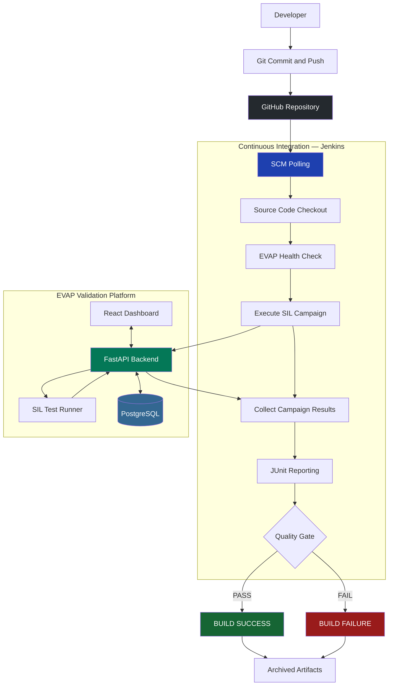
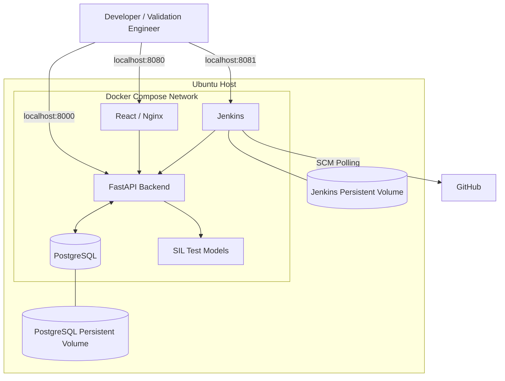
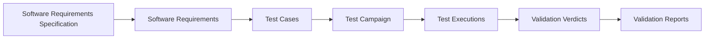
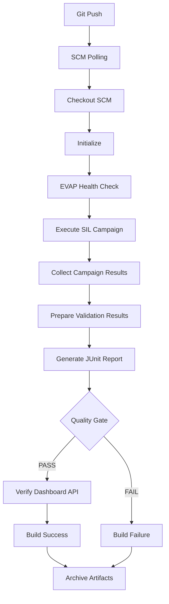
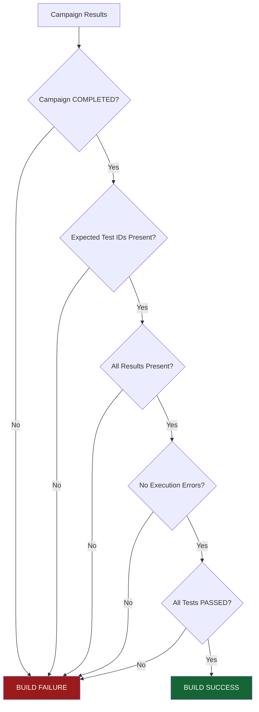
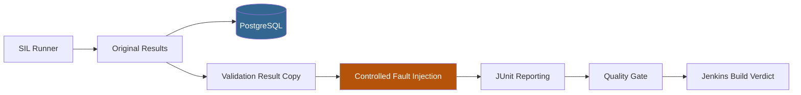

# EVAP — Operational Architecture v0.5

> A universal CI/CD validation platform for embedded software systems.

**Version:** v0.5 — CI/CD Integration
**Status:** Operational — Release Candidate Development
**Validation date:** 2026-11-14
**Reference commit:** b2ea4fe
**Reference Jenkins build:** #13

---

## 1. System Overview

EVAP (Embedded Validation Automation Platform) is a modular
platform designed to automate the validation of embedded
software systems throughout their development lifecycle.

The platform integrates:

- Software requirements management
- Requirements-to-test traceability
- Software-in-the-Loop (SIL) execution
- Automated test campaigns
- Continuous integration
- Quality gates
- Test reporting and execution history
- Persistent validation data

## 2. Operational System Architecture



## 3. Technology Stack

| Component | Technology | Responsibility |
|---|---|---|
| Source Control | Git / GitHub | Source code versioning |
| CI Orchestrator | Jenkins | Automated validation pipeline |
| Backend | Python / FastAPI | Validation orchestration |
| Frontend | React / Vite | Validation dashboard |
| Web Server | Nginx | Frontend delivery |
| Database | PostgreSQL 16 | Persistent validation data |
| Test Framework | pytest | Automated SIL tests |
| Infrastructure | Docker Compose | Service orchestration |
| Reporting | JSON / JUnit XML | Validation evidence |

## 4. Deployment Architecture



### Service Interfaces

| Service | Host Interface | Internal Interface |
|---|---|---|
| Jenkins | localhost:8081 | jenkins:8080 |
| Frontend | localhost:8080 | frontend:80 |
| Backend | localhost:8000 | backend:8000 |
| PostgreSQL | Not exposed | db:5432 |

All published service ports are bound to the local host.

Jenkins does not require privileged container access
or access to the Docker Engine socket.

## 5. Requirements Traceability



EVAP supports importing software requirements from Excel
and mapping requirements to validation test cases.

## 6. Automated CI/CD Pipeline

The Jenkins pipeline is defined as code in the Jenkinsfile.



### Automatic Trigger

The Jenkins pipeline checks for source code changes
approximately every five minutes.

```groovy
triggers {
    pollSCM('H/5 * * * *')
}
```

SCM polling enables automatic validation without exposing
the local Jenkins instance to the public Internet.

The default validation scenario is NORMAL.

Automatic triggering was successfully demonstrated
by Jenkins Build #13.

## 7. SIL Validation Scope

| Test Case | Requirement | Validation |
|---|---|---|
| TC-004 | SW-004 | CAN communication timeout |
| TC-008 | SW-008 | Startup initialization |
| TC-009 | SW-009 | CAN message transmission |
| TC-011 | SW-011 | State of Charge calculation |

The current SIL implementation uses demonstration
software models.

Eight additional test cases are mapped but are not
currently executable through the SIL runner.

## 8. Quality Gate Architecture



A campaign is accepted only when:

- Campaign status is COMPLETED.
- All four expected test cases are present.
- All execution environments are SIL.
- All four tests have passed.
- No functional failures are reported.
- No execution errors are reported.

## 9. Controlled Fault Injection



Synthetic fault injection modifies a copy of the campaign
report without modifying the original execution verdicts
stored in PostgreSQL.

Supported scenarios:

| Scenario | Expected Build Verdict |
|---|---|
| NORMAL | SUCCESS |
| TEST_FAILURE | FAILURE |
| EXECUTION_ERROR | FAILURE |
| MISSING_RESULT | FAILURE |
| INTERRUPTED | FAILURE |

## 10. Quality Gate Validation Evidence

| ID | Build | Scenario | Expected | Actual | Validation |
|---|---|---|---|---|---|
| VT-001 | 6 | NORMAL | SUCCESS | SUCCESS | PASS |
| VT-002 | 7 | TEST_FAILURE | FAILURE | FAILURE | PASS |
| VT-003 | 8 | EXECUTION_ERROR | FAILURE | FAILURE | PASS |
| VT-004 | 9 | MISSING_RESULT | FAILURE | FAILURE | PASS |
| VT-005 | 10 | INTERRUPTED | FAILURE | FAILURE | PASS |
| VT-006 | 11 | NORMAL Recovery | SUCCESS | SUCCESS | PASS |
| VT-007 | 7-11 | Data Integrity | PASS | PASS | PASS |
| VT-008 | 13 | Automatic SCM Trigger | SUCCESS | SUCCESS | PASS |

All eight listed validation checks passed.

The integrity of campaigns 10 through 14 was independently
verified through the EVAP API.

## 11. Validation Artifacts

Jenkins archives the following validation artifacts,
when generated:

- campaign-request.json
- campaign-response.json
- campaign-details.json
- validation-results.json
- junit-results.xml
- dashboard.json

Original campaign results and synthetic validation results
are stored in separate JSON artifacts.

## 12. Operational Metrics

Snapshot recorded after Jenkins Build #13.

| Metric | Value |
|---|---:|
| Software Requirements | 12 |
| Test Cases | 12 |
| Mapped Requirements | 12 |
| Mapping Coverage | 100% |
| Executed Unique Test Cases | 4 |
| Execution Coverage | 33.33% |
| Total Test Executions | 73 |
| Passed Executions | 73 |
| Failed Executions | 0 |
| Error Executions | 0 |
| Execution Pass Rate | 100% |
| Campaign Records | 16 |
| Jenkins Builds | 13 |

The execution pass rate describes recorded executions,
not the validation coverage of the entire software system.

## 13. Current Limitations

- SIL tests currently validate demonstration models,
  not production ECU software.
- HIL integration is not yet operational.
- Jenkins validates the currently deployed backend.
- The deployed backend is not yet cryptographically
  linked to the checked-out Git revision.
- Backend unit tests are not yet integrated into Jenkins.
- Synthetic failure scenarios validate report handling
  and quality gate behavior, not actual runner failures.
- Synthetic JUnit results share the nominal build trends.
- The backend health endpoint still reports version 0.3.0.
- Automatic deployment is not yet implemented.

## 14. Development Roadmap

| Version | Capability | Status |
|---|---|---|
| v0.1 | Foundation | Implemented |
| v0.2 | Web Platform | Implemented |
| v0.3 | Test Execution | Implemented |
| v0.4 | Campaign Manager | Implemented |
| v0.4.1 | Execution Reliability | Implemented |
| v0.5 | CI/CD Integration | In Progress |
| Future | Reproducible Build-to-Test Traceability | Planned |
| Future | Advanced SIL / HIL Integration | Planned |

### Remaining v0.5 Work

1. Backend unit test integration.
2. Build-to-test traceability.
3. Version management.
4. Final release validation.

---

EVAP — Embedded Validation Automation Platform

A universal CI/CD validation platform for embedded
software systems.
