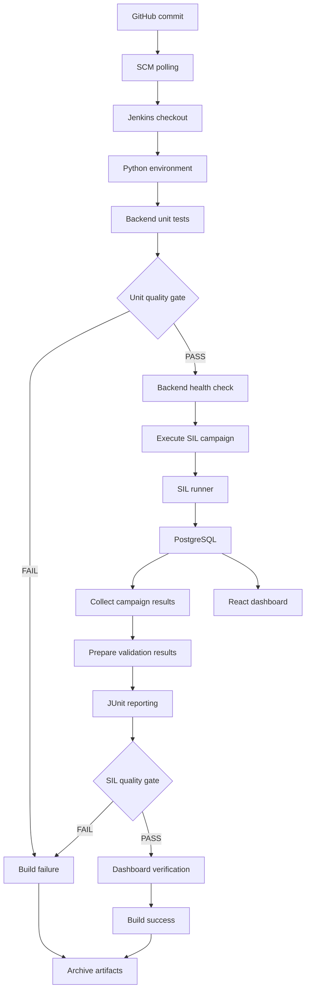

# EVAP — Pipeline Validation Report v0.5

> A universal CI/CD validation platform for embedded software systems.

| Field | Value |
|---|---|
| Validation date | 2026-11-14 |
| Release status | Release candidate |
| Branch | feature/evap-cicd-integration-v0.5 |
| Reference commit | 333c3a5fdc8b35195c1a8e2313bcf96b1bf8f2d6 |
| Pipeline | EVAP-CI-CD |
| Final build / campaign | 27 / 28 |
| Validation verdict | PASS — demonstration scope |

## 1. Executive summary

The operational pipeline integrates automatic SCM polling, backend unit tests, automated SIL campaigns, independent quality gates, JUnit reporting and artifact archiving. Nine builds behaved as expected and all 21 defined pipeline validation criteria were satisfied within the demonstration scope. The final nominal recovery build succeeded.

## 2. Operational architecture

## 3. Environment and test scope

Ubuntu, Docker Compose, Jenkins, GitHub, Python 3.11, FastAPI, PostgreSQL 16, React and pytest. SCM polling uses `H/5 * * * *`. Backend tests run on checked-out source in an isolated virtual environment; SIL runs through the deployed backend.

| Backend unit test area | Count |
|---|---:|
| Campaign recovery | 1 |
| Verdict classification | 5 |
| Runner timeout persistence | 1 |
| Subprocess timeout handling | 1 |
| Total | 8 |

| SIL test | Requirement | Area |
|---|---|---|
| TC-004 | SW-004 | CAN communication timeout |
| TC-008 | SW-008 | Startup initialization |
| TC-009 | SW-009 | CAN transmission |
| TC-011 | SW-011 | State of charge calculation |

These SIL tests exercise demonstration models, not production ECU software.

## 4. Build validation matrix

| Build | Scenario | Expected | Actual | Verdict |
|---|---|---|---|---|
| 19 | Automatic SCM / NORMAL | SUCCESS | SUCCESS | PASS |
| 20 | UNIT_TEST_FAILURE | FAILURE | FAILURE | PASS |
| 21 | Unit test recovery | SUCCESS | SUCCESS | PASS |
| 22 | Repeated UNIT_TEST_FAILURE | FAILURE | FAILURE | PASS |
| 23 | TEST_FAILURE | FAILURE | FAILURE | PASS |
| 24 | EXECUTION_ERROR | FAILURE | FAILURE | PASS |
| 25 | MISSING_RESULT | FAILURE | FAILURE | PASS |
| 26 | INTERRUPTED | FAILURE | FAILURE | PASS |
| 27 | NORMAL recovery | SUCCESS | SUCCESS | PASS |

A failed Jenkins build is the expected outcome of a negative validation scenario.

## 5. Pipeline validation tests

| ID | Criterion | Evidence | Verdict |
|---|---|---|---|
| PVT-001 | Automatic SCM trigger | 18–19 | PASS |
| PVT-002 | Git checkout | 19 | PASS |
| PVT-003 | Python 3.11 | 19 | PASS |
| PVT-004 | Dependency integrity | 19 | PASS |
| PVT-005 | Backend unit tests | 27 | PASS |
| PVT-006 | Backend JUnit reporting | 27 | PASS |
| PVT-007 | Unit gate success | 27 | PASS |
| PVT-008 | Health check | 19 | PASS |
| PVT-009 | SIL campaign execution | Campaign 28 | PASS |
| PVT-010 | SIL JUnit reporting | 27 | PASS |
| PVT-011 | SIL gate success | 27 | PASS |
| PVT-012 | Dashboard verification | 27 | PASS |
| PVT-013 | Artifact archiving | 27 | PASS |
| PVT-014 | Unit failure detection | 20 | PASS |
| PVT-015 | SIL execution prevention | 20, 22 | PASS |
| PVT-016 | Functional failure detection | 23 | PASS |
| PVT-017 | Execution error detection | 24 | PASS |
| PVT-018 | Missing result detection | 25 | PASS |
| PVT-019 | Interrupted campaign detection | 26 | PASS |
| PVT-020 | Database integrity | Campaigns 24–28 | PASS |
| PVT-021 | Nominal recovery | 27 | PASS |

## 6. Controlled fault injection

| Scenario | Passed | Failed | Errors | Available | Status |
|---|---:|---:|---:|---:|---|
| NORMAL | 4 | 0 | 0 | 4 | COMPLETED |
| TEST_FAILURE | 3 | 1 | 0 | 4 | COMPLETED |
| EXECUTION_ERROR | 3 | 0 | 1 | 4 | COMPLETED_WITH_ERRORS |
| MISSING_RESULT | 3 | 0 | 0 | 3 | COMPLETED |
| INTERRUPTED | 4 | 0 | 0 | 4 | INTERRUPTED |

SIL injection modifies a validation copy, not the stored verdicts. Each negative SIL build still executes four actual demonstration tests. UNIT_TEST_FAILURE injects a temporary failing pytest test and prevents SIL execution.

## 7. Database integrity and recovery

| Campaign | Build | Actual results | Integrity |
|---|---:|---|---|
| 24 | 23 | 4/4 PASSED | PASS |
| 25 | 24 | 4/4 PASSED | PASS |
| 26 | 25 | 4/4 PASSED | PASS |
| 27 | 26 | 4/4 PASSED | PASS |
| 28 | 27 | 4/4 PASSED | PASS |

API verification confirmed COMPLETED status, four expected test IDs, SIL environment and PASSED verdicts for all five campaigns. Build 27 recorded eight unit tests passing in 0.77 s, both quality gates passing, JUnit recording, artifact archiving and SUCCESS.

## 8. Archived artifacts

All seven non-empty files were observed in build 27:

| File | Purpose |
|---|---|
| backend-unit-results.xml | Unit test report |
| campaign-request.json | Campaign request |
| campaign-response.json | Campaign response |
| campaign-details.json | Actual campaign results |
| validation-results.json | Quality gate input |
| junit-results.xml | SIL report |
| dashboard.json | Metrics snapshot |

## 9. Operational metrics

Historical snapshot after build 27, not live metrics.

| Metric | Value |
|---|---:|
| Requirements / test cases / mapped requirements | 12 / 12 / 12 |
| Mapping coverage | 100% |
| Unique executed SIL tests | 4 |
| Test execution coverage | 33.33% |
| Total / passed SIL executions | 121 / 121 |
| Failed / error executions | 0 / 0 |
| SIL pass rate | 100% |
| Backend unit tests | 8 |
| Pipeline validation criteria | 21/21 |
| Build validation matrix | 9/9 |
| Final campaign integrity | 5/5 |

## 10. Limitations and release readiness

- Demonstration SIL models only; HIL execution is not integrated.
- Synthetic faults validate gate behavior, not actual runner failures.
- Synthetic failures contribute to Jenkins JUnit statistics.
- Checked-out Git identity does not guarantee deployed backend or SIL source identity.
- Structured build-to-test metadata and version alignment remain pending.
- Historical artifacts may be removed by Jenkins retention; the report is a summary, not a raw evidence archive.
- Production readiness is not established.

Remaining work: build-to-test traceability, version management and deployed source identification, final release verification.

**Operational pipeline validation: PASS. Final v0.5 release: PENDING.**
